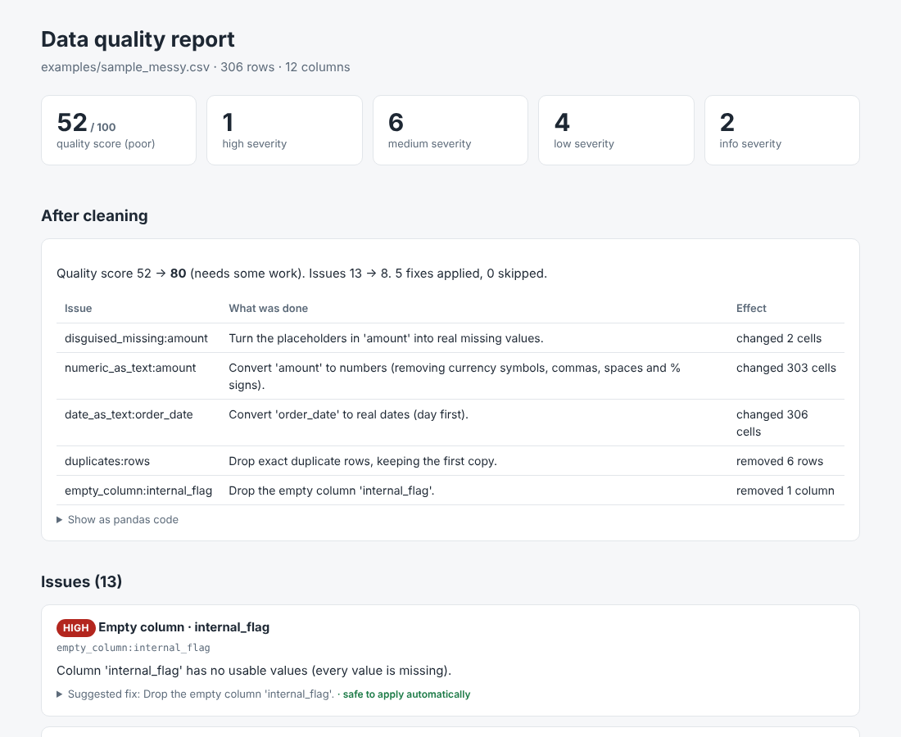
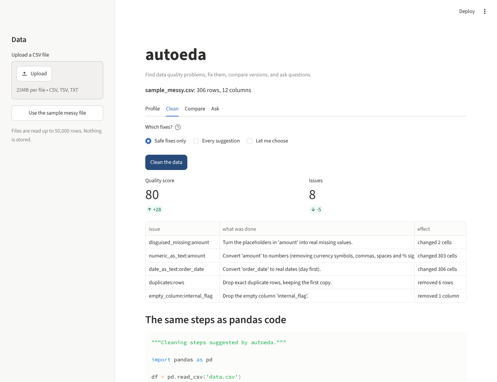
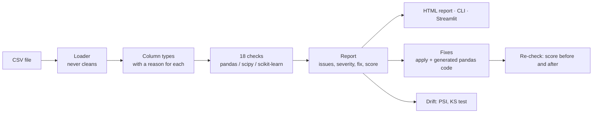
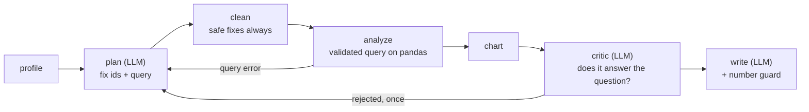

# autoeda

[](https://github.com/SarthakCodes170607/autoeda/actions/workflows/ci.yml)

**Find the data-quality problems in a CSV file, rank them by severity, fix them with code you can read, and ask questions in plain English.**

autoeda profiles a table, reports 18 kinds of problems (placeholder text standing in for blanks, prices stored as text, impossible values, duplicate rows, dates in the wrong format and more), suggests a pandas fix for each, applies the safe ones, and shows the quality score before and after. On top of that sits an AI data analyst: a LangGraph pipeline in which a local model (Ollama) picks the fixes and the query, ordinary code runs them, and every number in the written answer is checked against the data.

<p>
  
  
</p>

## Try it

```bash
git clone https://github.com/SarthakCodes170607/autoeda
cd autoeda
python -m venv .venv
.venv\Scripts\activate            # Windows. On macOS/Linux: source .venv/bin/activate
pip install -e ".[dev,agent,app]"

autoeda profile examples/sample_messy.csv --out report.html
autoeda clean examples/sample_messy.csv --out cleaned.csv --script clean.py
streamlit run streamlit_app.py
```

The sample file is 306 rows of invented sales data with a planted problem of each common kind. Profiling it scores 52 out of 100; the safe fixes bring it to 80.

### Command line

| Command | What it does |
|---|---|
| `autoeda profile FILE --out report.html --json report.json --fail-on high` | Lists problems, writes an HTML/JSON report, exits with code 1 if anything at that severity exists (useful in CI). |
| `autoeda clean FILE --out cleaned.csv --script clean.py [--all]` | Applies the safe fixes (or every suggestion with `--all`) and writes the cleaned file plus the same steps as a pandas script. |
| `autoeda drift OLD.csv NEW.csv --out drift.html` | Compares two versions of a table: shifted averages, new categories, more missing values, schema changes. |
| `autoeda ask FILE "total sales by region?"` | Answers a question with a local Ollama model. |

### Python

```python
from autoeda import profile, clean, compare

report = profile("orders.csv")
print(report.summary_text())

result = clean("orders.csv")  # safe fixes only
print(result.summary_text())  # quality score 52 -> 80, what was done
result.df.to_csv("orders_clean.csv", index=False)
print(result.code)  # the same steps as pandas code

drift = compare("last_month.csv", "this_month.csv")
```

### Ask questions (needs a local model)

```bash
ollama pull qwen2.5:7b-instruct          # about 4.7 GB, fits in 8 GB of GPU memory
autoeda ask examples/sample_messy.csv "What are the total sales for each city?" --steps
```

### Deploy the web demo

The demo is a single Streamlit app (`streamlit_app.py`, `requirements.txt` included). Push the repo to GitHub, open <https://share.streamlit.io>, choose the repo and `streamlit_app.py`. Uploads are capped at 50,000 rows to fit the free tier. The "ask in English" box needs an Ollama server, so on the hosted demo use the no-model query builder below it.

## How it works



### The AI analyst



* The model never writes code. It fills in a small validated query (`aggregate`, `top_k`, `describe`, `correlation`, `value_counts`, `trend`, with filters). Bad column names or wrong types raise an error that is sent back to the model for one repair attempt.
* Safe fixes are always applied. The model can add judgment fixes (such as treating `-999` as missing) by naming issue ids that actually exist; unknown ids are dropped.
* Every number in the written answer must appear in the result table (allowing rounding, percentages and thousands). If one does not, a plain answer built without the model is returned instead.

## Results

Everything below is produced by scripts in `benchmark/` and can be re-run. Raw output is in `benchmark/results/`.

### Detectors (`benchmark/detector_bench.py`)

Known problems are injected into six clean tables (iris, wine, diabetes, breast cancer, and two synthetic ones) at an easy and a hard level, 20 trials per problem and table. A problem counts as found if the matching issue is reported for the right column.

| Problem | Recall (easy / hard) | Precision |
|---|---|---|
| placeholder text (`?`, `N/A`, `unknown`) | 100% / 100% | 100% |
| numbers stored as text (`$1,234.50`), duplicate rows, dates as text, missing values, whitespace, mixed case, constant / empty column, near-duplicate columns, sentinel codes (`-999`) | 100% / 100% | 100% |
| outliers | 100% / **59%** (0.5% of rows at only 5-6 standard deviations) | 100% |
| unusual rows (multivariate) | 0%–100% depending on the table (row-level) | 0 rows flagged on 3 of 6 clean tables, at most 3 on the others |

How to read this: the injected problems are the ones the detectors were designed around, so the near-perfect rows show the detectors do what they claim, not that every real-world problem gets caught. The weak spots are real: mild outliers are missed by design (a 1.5 × IQR rule would flag about 1 in 150 normal values, so the report demands extreme values or a cluster of them), and the multivariate check only finds rows that are clearly off the data's overall shape; on tables with many correlated columns it finds little. See `DESIGN.md`.

### Agent (`benchmark/agent_bench.py`)

Sales tables are generated, correct answers are computed with plain pandas on the clean version, and the table is then made messy (currency text, mixed case, padded text, dd/mm/yyyy dates, 5% duplicate rows, `-999` ages). 14 questions × 5 tables = 70 per row.

| | Correct | Wrong | No answer |
|---|---:|---:|---:|
| Query the raw messy table | 14% | 29% | 57% |
| Profile and clean first, then query | **100%** | 0% | 0% |

This run uses a scripted planner that always asks the right question, which isolates what the cleaning step is worth. It is not a measurement of any language model. To measure a real model on your machine:

```bash
python benchmark/agent_bench.py --planner ollama --model qwen2.5:7b-instruct --seeds 3
```

### Speed (`benchmark/speed_bench.py`)

12 mixed columns with missing values, duplicates and outliers, measured on a 2-core cloud container (a modern laptop should be faster):

| Rows | `profile()` | `clean()` incl. re-check |
|---:|---:|---:|
| 100,000 | 2.3 s | 1.6 s |
| 505,000 | 10.9 s | 8.4 s |
| 1,010,000 | 23.8 s | 17.8 s |

Time grows linearly with rows.

## Design choices that matter

* **Library first.** Statistics come from pandas, numpy, scipy and scikit-learn (IQR fences, `skew`, `ks_2samp`, `chi2`, `EmpiricalCovariance`, `pd.to_numeric`, `pd.to_datetime`, `DataFrame.duplicated`). Custom code is limited to judgment (what counts as a problem, how severe, which fix) and glue.
* **The loader never cleans.** If it silently turned `?` into a missing value, the tool could not report `?` as a problem.
* **Safe versus judgment fixes.** Stripping spaces, reading numbers and dates, merging spellings, dropping exact duplicates and empty columns, and turning placeholder text into missing values are automatic. Filling missing values, clipping outliers, dropping columns and log transforms are only applied when asked for.
* **Generated code is tested against the real thing.** Every fix is applied by `apply_fix` and also written as a pandas snippet by `fix_to_code`; the tests run both on the same table and require identical results.
* **Warnings are errors in the tests** (`-W error`), so no pandas deprecation slips through. The suite (291 tests) passes on Python 3.10 with pandas 2.3 and on Python 3.13 with pandas 3.1.

## Limitations

* Language-model quality is not measured here; the agent benchmark needs a local Ollama run.
* Checks work on a single table in memory; there is no streaming or database support.
* European decimals (`1,5`) and files that mix several date formats in one column are only partly understood.
* "Unusual rows" assumes the data forms one cloud; clustered or heavy-tailed data may produce none or too few results.
* The agent answers one question about one table; it does not join tables or run multi-step analyses.

## Project layout

```
src/autoeda/
  loader.py  types.py  rules.py  models.py       loading, column types, thresholds, result models
  checks/                                        the 18 checks
  profile.py  fixes.py  drift.py                 profile(), clean(), compare()
  charts.py  report.py  templates/  cli.py       charts, HTML report, command line
  agent/                                         LLM clients, query language, LangGraph pipeline, guards
streamlit_app.py                                 web demo
benchmark/                                       detector, agent and speed benchmarks + results
tests/                                           291 tests
```

Development: `pip install -e ".[dev,agent,app]"`, then `ruff check . && ruff format --check . && pytest`.

MIT licensed.
